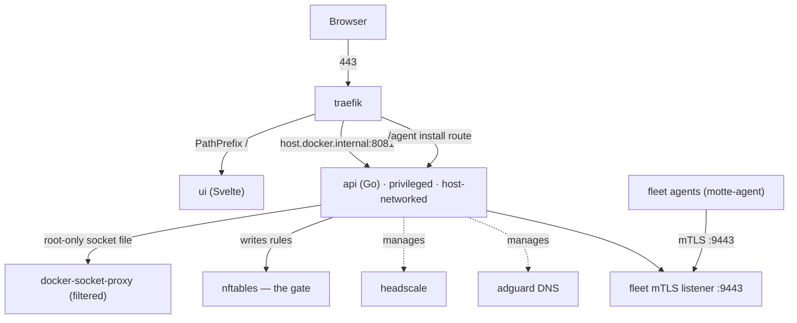
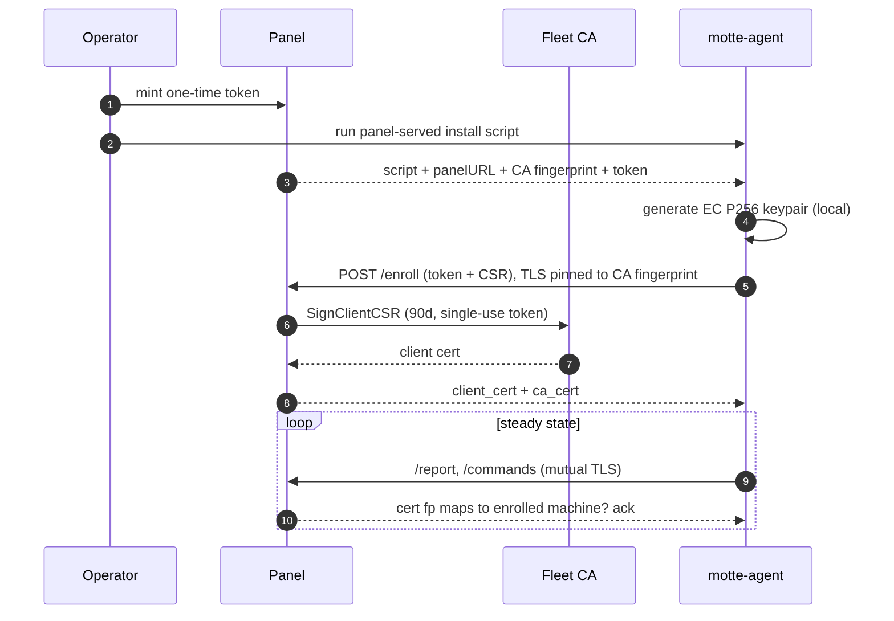
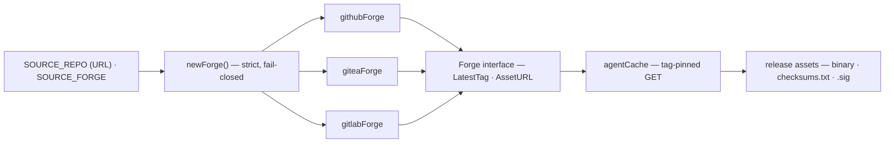
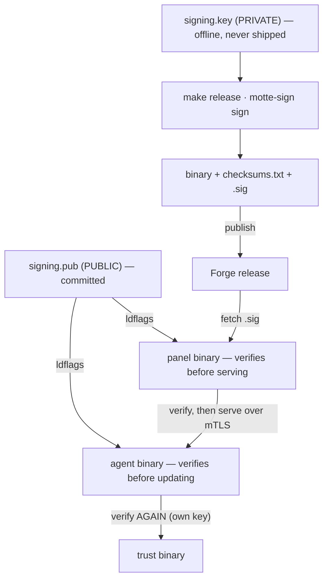
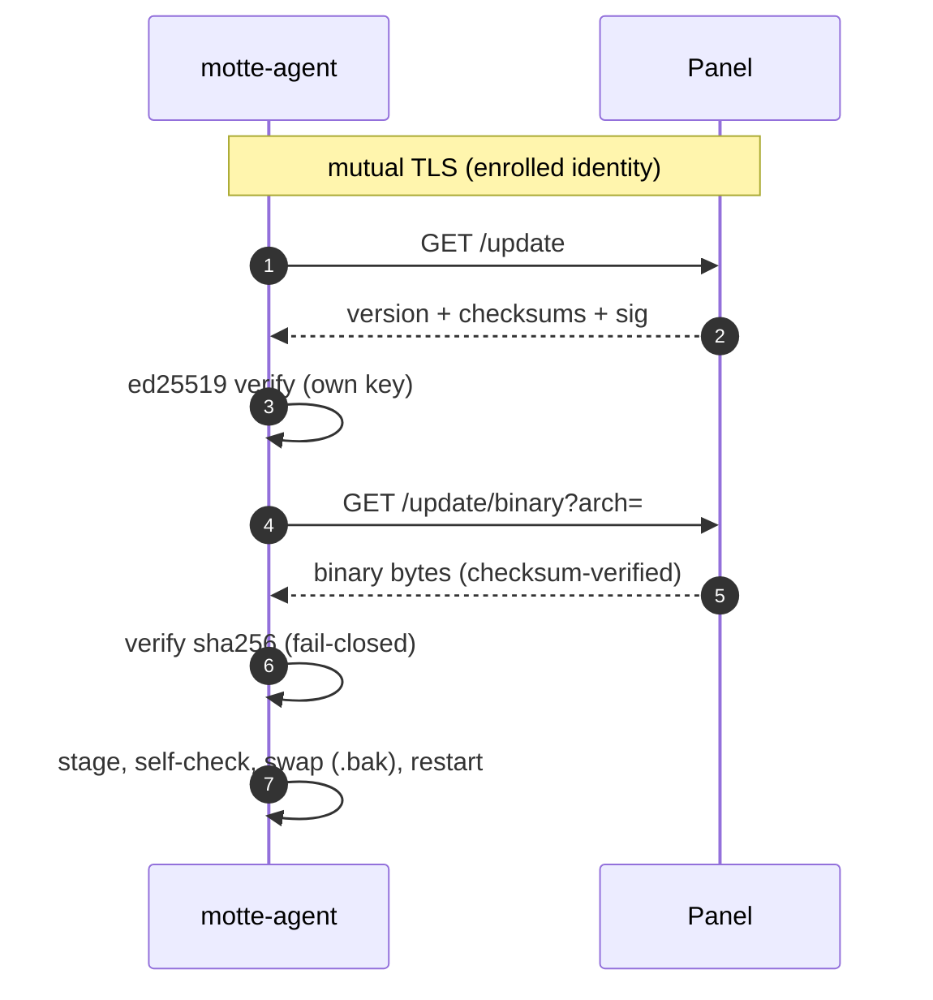
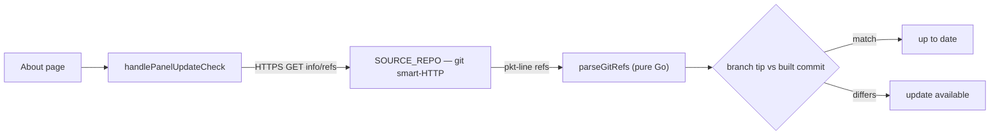

<p align="center">
  
</p>

<h1 align="center">Motte</h1>

<p align="center">
  <strong>Your infrastructure. Your stronghold.</strong><br>
  A self-hosted control panel for your VPNs, DNS, reverse proxy, firewall and server fleet.
</p>

<p align="center">
  <a href="https://github.com/packalyst/motte/actions/workflows/ci.yml"></a>
  
  
  
  
</p>

---

Motte runs on one Linux server and brings the pieces of a private network under one login:
WireGuard and Headscale (Tailscale-compatible) VPNs, AdGuard Home DNS, a Traefik reverse proxy,
an nftables firewall that is the single gate for all traffic, and a signed agent that watches,
protects and opens a browser shell on every machine in your fleet.

- **Contents:** [Features](#features) · [Quick start](#quick-start) · [Configuration](#configuration) · [Security](#security) · [Architecture](#architecture) · [Documentation](#documentation) · [Development](#development) · [License](#license)

## Features

### Networks and VPN

| | |
|---|---|
| **WireGuard + Headscale** | Manage WireGuard peers (with QR codes) and Headscale nodes from one client list; route between the two networks. |
| **Access rules** | VPN-to-VPN and per-client rules enforced in nftables, not only advisory ACLs. |
| **Virtual IPs** | Give a single LAN device (a camera, a printer) its own VPN address and decide who can reach it. |
| **Private LANs** | The panel can be the DHCP gateway for a private network on a spare interface (dnsmasq). |
| **DNS** | AdGuard Home with query logs, filtering per client and rewrites for VPN host names. |
| **Domains** | Publish internal services on your own domains through Traefik: VPN-only or public, with TLS. |
| **Tunnels** | Authenticated HTTP/SOCKS5 forward proxies, direct or through a VPN node, with IP rotation and webhooks. |

### Firewall and threat protection

| | |
|---|---|
| **One gate** | Default-drop nftables firewall rebuilt from the database; changes are checked with `nft -c` before they apply. |
| **Blocking** | Manual and automatic IP blocks, fail2ban-style jails that escalate to whole ranges, blocklist imports. |
| **Geo-blocking** | Block or allow by country (MaxMind, IP2Location or IPdeny), with automatic database updates. |
| **Panel lockdown** | Once a domain is set, close direct-IP access so the API is reachable only through the domain, localhost and the VPN. |

### Fleet

| | |
|---|---|
| **Agent** | A small signed agent enrolls each server over mutual TLS and reports health, CVEs and blocks. |
| **Vulnerabilities** | Trivy scans of OS packages and app lockfiles, grouped by OS and project, with targeted fixes. |
| **Protection** | CrowdSec bans and panel-pushed blocklists enforced in the agent's own firewall table; osquery file-integrity monitoring. |
| **Maintenance** | Apply updates, fix broken packages and update the kernel as live jobs; dry-run mode until you switch it on. |
| **Local veto** | Root on a server can switch the console, self-update or maintenance off for that machine, whatever the panel says. |
| **Self-update** | One click; the agent checks the release signature itself before it swaps. |

### Browser console

| | |
|---|---|
| **Real shell** | A full terminal to any fleet machine in the browser, over the agent's existing mTLS link. Nothing new to open. |
| **Sessions that survive** | tmux-backed: close the tab or lose the network and pick up where you were. Tabs and split view. |
| **Built-in tools** | File manager (upload, download, edit), git status, Docker, diagnostics, snippets and a command history. |
| **Recording and sharing** | Optional encrypted session recordings with a player, and read-only share links. |
| **Phone ready** | Its own iPhone-style keyboard and a row of terminal keys (esc, tab, ctrl, alt, arrows). |
| **Gated** | Off by default per machine, admin to switch on, re-authentication before opening a console, every session audited. |

### Monitoring

| | |
|---|---|
| **Analytics** | Inbound, DNS, outbound and firewall logs in one place: top talkers, a world map, charts from an hour to all time. |
| **Live stats** | CPU, memory, disk and network for the panel host and every machine, with history. |
| **Alerts** | Thresholds on CPU, memory and disk, delivered by push notification, webhook or email. |
| **Host security** | Listening ports, certificate expiry and recent package changes on the panel server. |
| **Routines** | Every background job visible, with last and next run, pause and run-now. |

### Operations

| | |
|---|---|
| **Backups** | Passphrase-sealed export of the whole configuration and a one-step import onto a new host; scheduled off-host copies to S3 or SFTP. |
| **Updates** | The panel tells you when a new version is out; `motte update` pulls and rebuilds. Optional image pinning and verification. |
| **App** | Installable on phone and desktop (PWA) with push notifications. |

## Quick start

**You need:** a Linux server with root access, Docker with Compose, and the WireGuard kernel
module.

```bash
curl -fsSL https://raw.githubusercontent.com/packalyst/motte/main/install.sh | sudo bash
```

This installs Motte into `/opt/motte`, registers a `motte` systemd service that starts on boot,
adds a `motte` command and starts the first-time setup. Then open `https://<your-domain>/` (or
`http://<server-ip>/`) and create the owner account in the setup wizard.

<details>
<summary>Install from a git checkout instead</summary>

```bash
git clone https://github.com/packalyst/motte.git
cd motte
./manage.sh            # interactive setup, then starts the stack
./manage.sh migrate    # optional: move this checkout to /opt/motte and register the service
```

</details>

### Everyday commands

| Command | What it does |
|---|---|
| `sudo motte` | Interactive menu |
| `sudo motte status` / `logs` | Service status, follow container logs |
| `sudo motte start` / `stop` / `restart` | Control the stack |
| `sudo motte update` | Check for and install updates |
| `sudo motte rotate-key` | Re-encrypt all secrets under a new encryption key |
| `sudo motte help` | Every command, including the supply-chain options |

### Adding a machine to the fleet

On the **Clients** page, add a machine to get an enrollment token and run the one-line installer it shows on
the server you want to add. The agent pins the panel's certificate, enrolls once and starts in
dry-run mode.

## Configuration

Settings live in `.env`, created from [`.env.example`](.env.example) during setup.

| Variable | Description | Default |
|---|---|---|
| `SERVER_IP` | Public IP of the server | detected |
| `ENCRYPTION_SECRET` | Key for secrets at rest (`openssl rand -hex 32`) | generated |
| `SSL_DOMAIN` | Domain for the panel and Let's Encrypt | — |
| `WG_PORT` | WireGuard UDP port | `51820` |
| `WG_IP_RANGE` | WireGuard client range | `10.8.0.0/16` |
| `HEADSCALE_IP_RANGE` | Headscale client range | `100.64.0.0/16` |

**What's exposed:** only the ports open in the panel's firewall, starting with `80`/`443`
(Traefik), WireGuard (`51820/udp`) and STUN (`3478/udp`). The Traefik dashboard, AdGuard's admin
UI and the Headscale API listen on localhost only, and the firewall keeps the panel API closed to
everything but Traefik, localhost and the VPN.

## Security

Motte holds the keys to your network, so it is built to fail closed:

- **The firewall is the gate.** nftables decides what reaches what; access rules elsewhere are advisory.
- **Accounts:** owner, admin, operator and viewer roles with per-machine scopes; TOTP and passkeys; re-authentication before sensitive actions; optional idle lock.
- **Sessions** live in an HttpOnly, SameSite=Strict cookie with CSRF checks and a strict Content Security Policy.
- **Secrets at rest** are encrypted with AES-256-GCM, with a key-rotation command; backups are sealed with Argon2id.
- **Docker access** goes through a filtering proxy that only the panel can reach (a root-only socket).
- **The fleet** is mutual TLS from a private CA, and agent releases are signed with an offline ed25519 key that both the panel and the agent verify. A compromised panel still cannot push a tampered agent.

Details: [security reference](docs/reference/security.md).

## Architecture

The supply chain for the fleet agent (`motte-agent`) is built so that **no single compromise — the panel included — can push a malicious binary**. The forge, host, and repo are all configurable; nothing about a specific repository is baked into the Go binary.

### Overall stack

The `api` runs in the host network namespace (privileged, `CAP_NET_ADMIN`) because it programs the host firewall — **nftables is the gate**. Being host-networked it has no Docker hostname, so Traefik reaches it at `host.docker.internal:8081`. It never touches the Docker socket directly, only a filtered `docker-socket-proxy`.



### Enrollment &amp; mTLS trust

A one-time token becomes a long-lived mutual-TLS identity. The agent generates its **own** keypair locally, pins the panel's **CA fingerprint** (no trust-on-first-use), and enrolls; the panel redeems the single-use token and signs a 90-day client cert. Every later call is gated at the TLS handshake against an enrolled, non-revoked machine.



### Forge abstraction

Identity comes from `SOURCE_REPO` (a full URL) + `SOURCE_FORGE`, derived by `manage.sh` from the git remote. `newForge` parses strictly (https only, exactly `owner/repo`, fail-closed on an unknown host) and returns a driver for GitHub, Gitea/Forgejo, or GitLab. Every URL segment is allowlist-validated and percent-escaped, and a forge-returned tag is re-validated before it can build a download URL.



### Release signing &amp; verification (ed25519)

The root of trust is an **offline ed25519 key**. On the release machine, `make release` signs `checksums.txt` with the **private** key (`signing.key` — never on the panel). The **public** key (`signing.pub`) is committed and compiled into **both** the panel and the agent. The panel verifies before serving; the agent verifies **again itself** — so even a compromised panel cannot feed a tampered binary. There is no unsigned fallback: a panel built without the key serves no agent release, an agent built without it never updates itself, and `make release` refuses to build one.



### Agent self-update via the panel

An agent updates by asking **its own panel** over the CA-pinned mTLS channel — it has **no forge coupling**. It verifies the signature with its own baked-in key, then the SHA-256, then stages beside the live binary, self-checks it runs, atomically swaps in a `.bak`, and restarts after the ack flushes.



### Panel update-check

The panel deploys by `git pull`, so its version is the commit it was built from. Its "is there an update?" answer uses the **git smart-HTTP protocol** — a plain HTTPS GET of `info/refs`, parsed in pure Go. No git binary, no subprocess, so there is no `ext::`/`file://` command-execution surface. The About page shows the resulting badge.



### Trust model summary

| Anchor | What it protects |
|--------|------------------|
| **Offline ed25519 signing key** (`signing.key`) | Authenticity of every agent release; private half never on the panel |
| **Baked-in public key** (`signing.pub`) | Panel and agent independently verify signatures; compiled in, not runtime-configurable |
| **Fleet CA** (ECDSA P256, encrypted at rest) | Issues agent client certs + the panel's mTLS server cert; only enrolled machines are obeyed |
| **CA-fingerprint pinning** | Closes trust-on-first-use at enrollment |
| **SHA-256 checksums** (verified twice) | Integrity of each downloaded binary, checked by panel *and* agent, fail-closed |
| **TLS / mutual TLS** | Report/command/update endpoints reject certless or foreign-cert connections at the handshake |

## Documentation

| | |
|---|---|
| [Reference](docs/reference/README.md) | How every part works, with file and line references: [architecture](docs/reference/architecture.md), [backend](docs/reference/backend.md), [frontend](docs/reference/frontend.md), [API](docs/reference/api-surface.md), [data model](docs/reference/data-model.md), [firewall](docs/reference/networking-firewall.md), [fleet agent](docs/reference/fleet-agent.md), [deployment](docs/reference/deployment.md), [security](docs/reference/security.md) |
| [Decisions](docs/adr/README.md) | Architecture decision records: why the API is host-networked, why nftables is the gate, how backups and releases are sealed, and more |
| [Changelog](CHANGELOG.md) · [Contributing](CONTRIBUTING.md) · [Security policy](SECURITY.md) | What changed, how to contribute, and how to report a vulnerability privately |

The **About** page inside the panel shows the running version, these diagrams and a live API
reference generated from the running schema.

## Development

Answer `y` to development mode during `./manage.sh` (or set `DEV_MODE=true` in `.env`) for hot
reload of the UI. CI checks formatting, `go vet`, the Go tests and the UI build on every push, plus
advisory security scans (gosec, govulncheck, staticcheck).

```
├── api/                 Go backend: cmd/ (entry point), configs/ (endpoints), internal/ (one package per area)
├── ui/                  Svelte 5 frontend: src/{views,components,stores,lib}
├── containers/          Images built here (dnsmasq, turbotunnels)
├── headscale/ traefik/ adguard/   Service configuration
├── deploy/              systemd unit and the motte command
├── docs/                Reference and decision records
├── docker-compose.yml   The stack
├── install.sh           Managed install to /opt/motte
└── manage.sh            Configure, update, migrate, rotate keys
```

## License

[GNU Affero General Public License v3.0](LICENSE).
